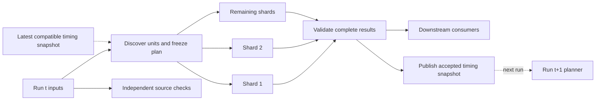

# Adaptive shard scheduling across pipeline runs

<!-- toc:start -->
**Table of contents**

- [Why fan-out and fan-in fit this approach](#why-fan-out-and-fan-in-fit-this-approach)
- [Planning and measurement contract](#planning-and-measurement-contract)
- [Objective and a checkable move rule](#objective-and-a-checkable-move-rule)
- [Consecutive-run scheduling loop](#consecutive-run-scheduling-loop)
- [Bounded feedback and stability](#bounded-feedback-and-stability)
- [Progressive work granularity](#progressive-work-granularity)
- [Polyad integration and evidence lifecycle](#polyad-integration-and-evidence-lifecycle)
- [Proposed experiment and acceptance evidence](#proposed-experiment-and-acceptance-evidence)
  - [Worked arithmetic](#worked-arithmetic)
<!-- toc:end -->

**Status: proposed study.** This documents an application-level scheduling idea
for repeated fan-out/fan-in workloads. It introduces no Polyad runtime feature,
CRD, refresh-suite entry, benchmark command, or measured performance claim.

The question is whether consecutive runs can use validated execution timings to
finish parallel shards closer together, reducing the slowest shard's contribution
to pipeline latency without continually reshuffling work. The starting point is
[resumeme's capture scheduler](https://github.com/astrivant/resumeme): an initial
coarse partition, measurements from complete captures, bounded feedback, and
progressively finer work units where independent traversal is possible.

## Why fan-out and fan-in fit this approach

A fan-out exposes independent work; its fan-in waits for the required results.
If one shard takes much longer, earlier finishers contribute no further progress
toward that barrier. Historical durations can improve where the next run assigns
work while preserving the same work contract and dependency graph.

This is **history-based adaptive scheduling**, combining runtime prediction with
bounded local search over a multi-way partition. Timing-based test splitting is
an established instance of historical cost allocation; see
[CircleCI's timing-based splitting documentation](https://circleci.com/docs/guides/optimize/parallelism-faster-jobs/).
The fixed-cost assignment is related to
[multi-way number partitioning](https://research.google/pubs/optimal-multi-way-number-partitioning/).
The proposed variance objective, feedback controls, and granularity policy need
their own evaluation; those references do not establish their performance.



The dotted feedback edge crosses run boundaries. Each individual execution stays
a DAG. Independent tests, builds, and checks should start as soon as their own
inputs are ready; the planner belongs only on the branch whose work it assigns.
This complements a shallow pipeline rather than adding a global scheduling gate.

For a single barrier, a useful timing model is:

```math
T = B + \max_{1\le i\le m}(Q_i + H_i + L_i) + F.
```

Here `B` is preparation time, `Q_i` is shard queue delay after fan-out, `H_i` is
startup/setup/teardown overhead, `L_i` is sequential useful traversal time including
in-process retries, and `F` is fan-in processing. The first experiment assumes
fixed, equivalent workers and additive per-unit costs. It cannot remove serial
work or guarantee control over queue delays. Across the full DAG, another branch
may remain the critical path even when this barrier improves.

## Planning and measurement contract

| Component | Responsibility |
| --- | --- |
| Work catalog | Discover current, stable unit IDs and allowed subdivisions; declare replay, ordering, affinity, and concurrency constraints. |
| Planner | Read compatible feedback, predict costs, produce deterministic assignments, and freeze one versioned plan before fan-out. |
| Worker | Execute its assigned units and record monotonic elapsed time, outcome, and attempt identity beside each result. |
| Fan-in | Validate plan/run identity, required shard coverage, unit coverage, and result contracts; restore semantic output order. |
| Feedback publisher | Atomically publish the accepted measurements, estimates, controller state, and assignments for a subsequent run. |

Every planned unit has one owning shard. Retries retain the same logical unit ID;
fan-in must reject conflicting results and accept at most one authoritative
result per unit. This is an output-validation rule, not an exactly-once execution
guarantee. Side effects require idempotency or an application-specific recovery
protocol. Empty shards still return an explicit completion record.

Time each unit separately. A shard total alone cannot identify which of its units
should move. Record queue, setup, execution, retry waiting, cleanup, and fan-in
times separately so the controller does not mistake slow runner provisioning for
expensive input data. Keep worker concurrency fixed in the initial experiment;
sequential per-unit durations cannot simply be added when work overlaps internally.

A timeout is a censored observation, not a completed duration. Preserve it for
failure analysis instead of learning that the interrupted unit became cheap.
The initial feedback policy accepts only complete, validated collections; it
must report failure rates separately to make this successful-run selection bias
visible. Unrelated downstream build failures need not invalidate an otherwise
complete collection's timing snapshot.

## Objective and a checkable move rule

For positive predicted unit costs `c_j`, a fixed worker count `m`, and disjoint
assignments `S_i`, define population statistics over all shards, including empty
ones:

```math
L_i=\sum_{j\in S_i}c_j,\qquad
\mu=\frac{1}{m}\sum_i L_i,\qquad
D=\sum_i(L_i-\mu)^2,\qquad
\sigma=\sqrt{D/m},\qquad M=\max_i L_i.
```

The proposal reduces spread while requiring that the predicted slowest shard
`M` does not increase. At fixed units, costs, and worker count, redistribution
preserves the mean exactly. A lower mean requires less work, improved execution,
or different capacity; waiting deliberately on fast workers is not balancing.
No normal distribution or Gaussian fitting assumption is needed. Across runs,
changed inputs and cost predictions can change both the mean and the spread.

Consider a move or swap from shard `a` to shard `b`. Let `x` be the outgoing cost
minus the returning cost, with zero returning cost for a one-way move:

```math
L_a'=L_a-x,\qquad L_b'=L_b+x,\qquad
G=2x(L_a-L_b-x),\qquad D'=D-G.
```

`G` measures reduction in squared deviations, in squared seconds. Accept only
constraint-respecting moves with nonincreasing `M` and a meaningful improvement.
For example, requiring more than a 5% reduction in standard deviation means:

```math
\sigma'<0.95\sigma
\quad\Longleftrightarrow\quad
G>\bigl(1-0.95^2\bigr)D=0.0975D.
```

Use a scale-aware numerical tolerance as well. This threshold is 9.75% of the
squared-deviation sum, not 5% of the variance. Deterministic tie-breaking and a
small move budget make local search replayable. It need not find a global optimum;
compare its result with rebuilding the complete timing-based partition.

A lower coefficient of variation (`sigma / mean`, when mean is positive) helps
compare similar workloads across runs. It is insufficient alone: uniformly slow
shards can have zero spread. Also measure makespan and total useful work. For
simultaneous, identical workers with no overhead, `m * M - sum(L_i)` is idle
worker-time before the barrier. Actual queue/setup differences require observed
start and finish times to compute idle time.

## Consecutive-run scheduling loop

1. **Discover and start cold.** Begin with coarse, independently executable units.
   With no compatible timing history, use a deterministic baseline such as
   size-weighted Longest Processing Time first (LPT): sort units by descending
   estimated cost and place each on the least-loaded shard.
2. **Measure the actual run.** Workers report per-unit durations and outcomes.
   Fan-in validates all required outputs before timing feedback is accepted.
3. **Update predictions.** Match current units to the latest compatible evidence.
   New units get a documented estimate calibrated into seconds, rather than mixing
   raw size weights with measured seconds. Retire missing IDs and reset state when
   semantics change.
4. **Rebalance conservatively.** Start from the previous assignment, place new
   units, then consider legal moves and swaps against predicted load. For six
   shards, an initial budget could move at most two established units per run;
   a swap consumes both migrations. Count newly admitted or split units separately.
5. **Refine only an observed bottleneck.** If coarse units prevent useful balance,
   discover a bounded number of smaller, independently replayable units. Include
   their additional setup and result-merge costs in the next evaluation.
6. **Freeze and repeat.** Workers all receive the same immutable next-run plan.
   Feedback published by a concurrent run cannot change that plan halfway through
   execution. Keep the previous assignment when no candidate clears the threshold.

Predicted versus observed per-shard residuals diagnose model error; the scheduler
still needs unit-level measurements to choose what moves. Persistent residuals
associated with a particular worker suggest a capacity or overhead mismatch.
The initial homogeneous-worker model should flag that mismatch rather than
repeatedly moving the same expensive unit among unequal workers.

## Bounded feedback and stability

Test a simple exponentially weighted moving average (EWMA) as a baseline before
attributing benefit to PID. Both predict duration; a separate assignment policy
decides whether work moves. The related resumeme design uses a bounded PID-style
correction per unit, with one completed run as the normalized time step.

For unit `j`, suppress the index and let `p_t > 0` be its prediction, `y_t` its
observed duration, and `e_t = y_t - p_t`. A candidate correction is:

```math
u_t=K_P e_t+K_I I_t+K_D(e_t-e_{t-1}),\qquad
p_{t+1}=p_t+\operatorname{clip}(u_t,-\alpha p_t,\alpha p_t),
\qquad 0<\alpha<1.
```

`clip(z, a, b)` is `min(b, max(a, z))`. `I_t` is bounded accumulated error in
seconds per normalized run step. Freeze integral accumulation when saturation
would push farther in the error's direction, and bound the stored integral again
after updating the prediction. Reset state for a new unit or incompatible regime.
Small residuals can use a deadband that retains the estimate and clears stored
error. These rules must be explicit in any implementation and its replay data.

An initial comparison could reuse resumeme's 5% prediction deadband, 25% per-run
estimate-change limit, and gains `K_P=0.5`, `K_I=0.05`, `K_D=0.1`. These are
experimental starting points, not tuned stability guarantees. The correction
limit ensures `0.75 * p_t <= p_(t+1) <= 1.25 * p_t` for established units; it says
nothing by itself about observed completion time or assignment convergence.
Derivative feedback can amplify measurement noise. Compare persistent drift,
abrupt changes, and outliers before deciding whether the extra controller state
is justified over EWMA. Hysteresis, a migration budget, and optional minimum
residency protect assignments independently of predictor tuning.

## Progressive work granularity

Start macro, then split only where the barrier remains imbalanced. Require
sustained evidence above a chosen spread threshold and a material absolute time
cost. Bound discovery expense, the number of splits per run, and the total unit
count. Keep stable parent/child IDs so fan-in can reassemble the source structure.
A split replaces its parent assignment; scheduling both would duplicate work.

| Workload | Coarse unit | Possible finer unit | Required evidence |
| --- | --- | --- | --- |
| Test execution | Module or suite | Test case | Fixture isolation and setup cost accounting |
| Data processing | Dataset partition | Key range or independent batch | Disjoint coverage and deterministic merge |
| Browser collection | Profile section | Tab or stable paginated route | Independent navigation, complete coverage, and session isolation |
| Compilation or analysis | Component | Independent source group | Dependency and shared-cache constraints |

A sequential cursor chain or a stateful browser scroll is not automatically
splittable. Refinement can increase total work by duplicating navigation or setup;
a lower spread must earn back that overhead in barrier time. If an indivisible
unit dominates, report the granularity limit instead of promising convergence.
Keep shard count fixed initially so capacity changes do not obscure assignment
quality. Vary count and heterogeneous worker capacity in separate experiments.

## Polyad integration and evidence lifecycle

An application planner could materialize assignments for a finite
[Graph or nested graph boundary](../../docs/introduction/concepts.md#finite-pipelines).
Polyad would retain dependency, admission, placement, and lifecycle authority;
the proposed planner would own allocation within its permitted work boundary.
Existing [SDK adaptation strategies](../../docs/workloads/adaptation-strategies.md)
provide relevant observation and guard concepts, but no automatic cross-run shard
scheduler is claimed here. The [reachability routing study](../reachability-routing/README.md)
addresses live routing and queue safety; this proposal changes future immutable
batch plans instead of transferring already accepted work.

Define versioned schemas for the unit catalog, plan, worker result, and feedback
snapshot before implementing a controller. Scope evidence to the application,
work contract, worker class, concurrency, relevant configuration, and scheduler
version. Record the source revision for audit; do not make every commit invalidate
otherwise compatible history. Model significant execution changes explicitly.

Use the latest accepted compatible snapshot with an expiry policy. Persist
controller state and the prior assignment alongside durations; duration-only
records cannot reproduce PID behavior. Reject malformed, nonfinite, nonpositive,
stale, or incompatible timing values. Unavailable history selects the cold-start
baseline without bypassing work validation. Atomic, versioned publication must
prevent an older concurrent run from replacing newer accepted feedback.

Store timing metadata and opaque unit IDs rather than payloads or credentials.
Authenticate feedback and restrict writers; encrypt it when identifiers or scope
are sensitive, especially in shared CI caches. Raw benchmark evidence follows
the normal [study refresh protocol](../README.md#refresh-protocol), separately
from the small snapshot required for the next schedule.

Shared API throttling, bandwidth, memory, or database capacity can couple workers.
A 429 delay is evidence of a shared constraint, not necessarily an expensive unit.
Keep retry and rate-limit time visible, honor retry hints, and constrain fan-out
before interpreting such delays as a reason to redistribute work.

## Proposed experiment and acceptance evidence

The initial experiment would use six equal workers across ordered runs of the
same evolving workload. Pair strategies on identical inputs and controlled
seeds; separate warmup from evaluation and keep the learning chronology intact.
A replay may use synthetic durations to verify decisions, but wall-clock benefit
requires measured execution and its overhead.

| Comparator or scenario | Question |
| --- | --- |
| Static hash/equal-count and size-based LPT | Does observed duration improve on an unchanged baseline? |
| Full timing-based LPT each run | What balance is possible without preserving prior assignments? |
| EWMA plus bounded moves; PID plus the same moves | Does PID add value beyond smoothing and assignment hysteresis? |
| Coarse units; bounded progressive refinement | Does finer allocation repay discovery, startup, and merge expense? |
| Stable costs, slow drift, step changes, long tails, added/removed units | How quickly does the scheduler adapt, and how much does it churn? |
| Failed retries, shared throttling, worker slowdown, stale/concurrent feedback | Does the planner preserve correctness and identify model limits? |

Record per-unit predicted/observed seconds, per-shard loads, mean, population
standard deviation, coefficient of variation, maximum duration, barrier wall
clock, total worker-seconds, prediction error, migrations, refinements, planner
cost, failures, and completion counts. Plot predicted versus observed loads,
barrier time and spread across runs, and migration count on a separate axis.
Publish paired results and uncertainty rather than a single favorable run.

Required correctness checks include exact unit coverage, deterministic plans,
work conservation under fixed-cost moves, nonincreasing predicted makespan for
accepted moves, controller and migration bounds, valid refinement replacement,
and rejection of mixed-run results. Reducing spread must not hide missing work.
A useful outcome improves observed barrier latency at a comparable work and
resource budget while keeping churn bounded. A negative result should identify
whether overhead, prediction noise, granularity, or external limits dominate.

### Worked arithmetic

This illustrative move is not a benchmark. Moving a ten-second unit from a
120-second shard to an 80-second shard preserves the mean, reduces the maximum,
and quarters variance (halves standard deviation):

```pycon
>>> from fractions import Fraction
>>> from statistics import mean, pvariance
>>> before = [120, 80, 100, 100, 100, 100]
>>> after = [110, 90, 100, 100, 100, 100]
>>> mean(before), mean(after), max(before), max(after)
(100, 100, 120, 110)
>>> gain = 2 * 10 * (120 - 80 - 10)
>>> Fraction(gain, 6) == pvariance(map(Fraction, before)) - pvariance(map(Fraction, after))
True
>>> pvariance(after) / pvariance(before)
0.25
>>> 1 - (1 - Fraction(5, 100)) ** 2
Fraction(39, 400)
>>> 6 * max(before) - sum(before), 6 * max(after) - sum(after)
(120, 60)

```

Run these standard-library examples with `python -m doctest
studies/adaptive-shard-scheduling/README.md`. Mathematical syntax validation and
these examples catch different errors; neither proves controller stability or
performance. This proposal has no registered measurement recipe yet. A future
harness should live in `polyad-benchmarks`, with fixtures and measured artifacts
under this study's directory, following the existing study conventions.
